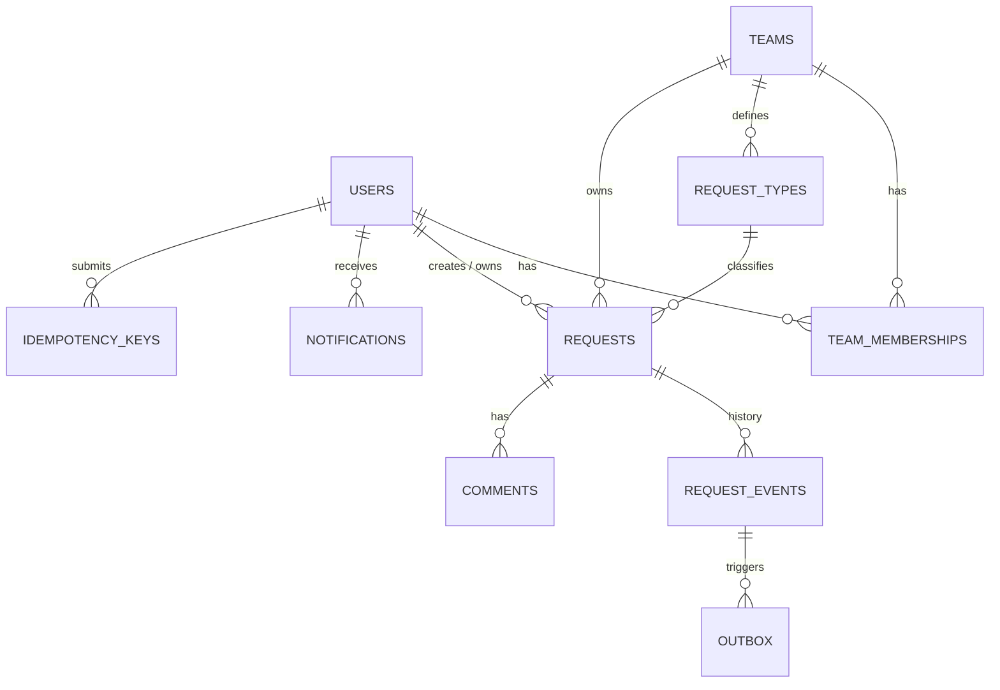
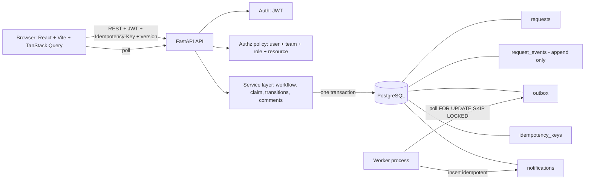

# System Design: Operations Under Pressure

Derived from the Newtonite candidate brief. Sections: (1) Requirements, (2) Core entities, (3) API endpoints, (4) LLD, (5) HLD.

---

## 1. Requirements

### 1.a Functional requirements (what the system must do)

**FR-1 Work items**
- Create, view, edit and list operational work items (requests).
- A request answers: what it is and why it exists, its current state, its importance, who is responsible, what happened before, what needs attention next.

**FR-2 Ownership**
- A request has at most one owner at a time.
- Users can claim unowned work; leads can reassign.
- Ownership changes are recorded with who/when/why.

**FR-3 Workflow**
- States: New, Triage, Awaiting start approval, In progress, Awaiting completion approval, Done, Cancelled.
- Approval steps are optional per request type (`approval_mode`: none / before / after / both).
- Illegal transitions are rejected by the backend.
- Rejections require a reason and send the request back to a defined state.

**FR-4 Teams, identity and access**
- Multiple teams; a user can belong to many teams with a different role in each (member, approver, lead).
- Authorization is enforced by the backend at the resource level (user + request's team + role).
- Separation of duties: the person who did the work cannot approve its completion.

**FR-5 Collaboration and history**
- Comments on requests.
- Append-only history of every important action (state, owner, priority, approvals, comments).
- Timeline view that explains "why did this happen".

**FR-6 Overview and discovery**
- Work list with filters (status, owner, priority, team, type) and full-text search.
- "My work", approver queue, and a manager "needs attention" view (unowned, stale, overdue, stuck in approval, urgent).

**FR-7 Concurrency behaviour**
- Two users claiming the same work: exactly one wins, the other gets a clear message.
- Editing stale data: rejected with the current state and what changed.
- Repeated submissions (retries): no duplicate effect.

**FR-8 Notifications (async)**
- Users are notified of relevant events (assigned, approval needed, approved/rejected, comment).
- Notification processing happens after the main action, survives failures and duplicate execution.

**FR-9 Delivery artifacts**
- Source code, run instructions, `ENGINEERING_DECISIONS.md`, automated tests, known limitations.

**Out of scope for v1 (intentional):** SSO, email/Slack delivery, file attachments, WebSocket presence, AI features (optional bonus only).

### 1.b Non-functional requirements (how well it must do it)

| Area | Requirement |
|---|---|
| **Scale** | Thousands of users, hundreds to few thousand concurrent, tens of thousands of active requests, continually growing history |
| **Performance** | List/search/detail respond fast (target p95 < 300 ms on seeded data); nothing loads the full dataset into the browser or app memory |
| **Consistency** | State change + history + outbox event are atomic; no lost updates; no double ownership |
| **Concurrency safety** | Atomic claim, optimistic locking, idempotent writes, safe under parallel requests |
| **Reliability** | Async work is at-least-once with idempotent handlers, retries with backoff, dead-letter for poison jobs; primary action never blocked by secondary work |
| **Security** | Backend-enforced authorization; no existence leaks (404 for non-members); hashed passwords; input validation |
| **Auditability** | Immutable event log; every decision traceable to actor, time, reason |
| **Maintainability** | Workflow rules in one module; thin routes; service layer owns transactions; clear module boundaries |
| **Testability** | Concurrency and workflow behaviour tested against real Postgres |
| **Usability** | Coherent, responsive UI over decorative UI; clear conflict and error messages |
| **Operability** | One-command local run (`docker compose up`), seed data, structured logs, health endpoint |
| **Growth path** | Design allows partitioning history, swapping outbox for a queue, adding search engine without rewriting core |

---

## 2. Core entities



| Entity | Purpose | Key fields |
|---|---|---|
| **User** | Person who logs in | id, email, name, password_hash |
| **Team** | Organizational unit | id, name |
| **TeamMembership** | Role of a user in a team | user_id, team_id, role (member / approver / lead); PK(user_id, team_id) |
| **RequestType** | Category + workflow config | id, team_id, name, approval_mode, sla_hours |
| **Request** | The work item (current state) | id, team_id, type_id, title, description, status, priority, owner_id, created_by, **version**, due_at, last_activity_at, search_tsv |
| **RequestEvent** | Append-only history | id, request_id, actor_id, type, from_value, to_value, reason, created_at |
| **Comment** | Discussion on a request | id, request_id, author_id, body, created_at |
| **IdempotencyKey** | Dedupe retried writes | user_id, key, endpoint, request_hash, response_status, response_body |
| **Outbox** | Reliable async hand-off | id, event_id, topic, payload, status, attempts, next_attempt_at, last_error |
| **Notification** | In-app message | id, user_id, request_id, kind, body, read_at, **dedupe_key (unique)** |

Enums:
- `status`: new, triage, awaiting_start_approval, in_progress, awaiting_completion_approval, done, cancelled
- `priority`: low, medium, high, urgent
- `role`: member, approver, lead
- `approval_mode`: none, before, after, both
- `outbox.status`: pending, processing, done, dead

---

## 3. API endpoints

Conventions: REST + JSON, `Authorization: Bearer <jwt>`, cursor pagination, error body `{code, message, details}`. Mutating endpoints marked **[IK]** accept `Idempotency-Key`; those marked **[V]** require the client's `version`.

### Auth
| Method | Path | Purpose |
|---|---|---|
| POST | `/auth/login` | Email + password, returns JWT |
| GET | `/me` | Current user, teams, roles |

### Requests
| Method | Path | Role needed (in request's team) | Purpose |
|---|---|---|---|
| GET | `/requests` | member+ | List with filters: `team, status, owner(me/none/id), priority, type, q, cursor, limit` |
| POST | `/requests` **[IK]** | member+ | Create (status = new) |
| GET | `/requests/{id}` | member+ | Detail incl. `version`, allowed actions for caller |
| PATCH | `/requests/{id}` **[V]** | owner or lead | Edit title/description/priority/due date |
| POST | `/requests/{id}/claim` **[IK]** | member+ | Atomic claim of unowned request |
| POST | `/requests/{id}/assign` **[V]** | lead | Reassign owner (with reason) |
| POST | `/requests/{id}/transition` **[IK][V]** | per workflow table | Body `{to, reason?}` |
| GET | `/requests/{id}/events` | member+ | Timeline, cursor paginated |
| POST | `/requests/{id}/comments` **[IK]** | member+ | Add comment |

### Views
| Method | Path | Role | Purpose |
|---|---|---|---|
| GET | `/approvals/queue` | approver / lead | Requests awaiting my approval |
| GET | `/attention` | lead | Buckets: unowned, stale, overdue, stuck in approval, urgent (with counts) |

### Notifications
| Method | Path | Purpose |
|---|---|---|
| GET | `/notifications` | My notifications (cursor) |
| POST | `/notifications/{id}/read` | Mark read |

### Ops
| Method | Path | Purpose |
|---|---|---|
| GET | `/health` | Liveness/readiness |

### Status codes
| Code | Meaning |
|---|---|
| 200/201 | Success (idempotent replays return the original response) |
| 401 | Not authenticated |
| 403 | Authenticated, role insufficient |
| 404 | Not found or caller not in the request's team |
| 409 | Version conflict, already claimed, illegal state transition |
| 422 | Validation error, or idempotency key reused with a different payload |

Conflict (409) response includes `current` state and `events_since_version` so the UI can show what changed.

---

## 4. Low-level design (LLD)

### 4.1 Module layout

```
backend/app/
  main.py                  # FastAPI app, routers, error handlers
  config.py                # thresholds (stale hours, SLA), DB url
  db.py                    # engine, session
  models/                  # SQLAlchemy models (one file per entity group)
  schemas/                 # Pydantic request/response models
  auth/
    security.py            # password hashing, JWT
    deps.py                # get_current_user
  authz/
    policy.py              # can(user_role, action, request, actor) -> bool
    deps.py                # require_permission("approve") dependency
  workflow/
    transitions.py         # TRANSITIONS table + validate_transition()
  services/
    requests.py            # create, edit, claim, transition, assign
    comments.py
    events.py              # append_event() + enqueue_outbox()
    idempotency.py         # with_idempotency() wrapper
    attention.py           # SQL for attention buckets
    queries.py             # list/search with keyset pagination
  routes/                  # thin: parse -> authz -> service -> response
  worker/
    outbox_worker.py       # poll loop, handlers, backoff, dead-letter
  seed.py
  tests/
frontend/src/
  api/                     # fetch client, idempotency-key helper, error mapping
  hooks/                   # useRequests, useRequest, useClaim, useTransition...
  pages/                   # Login, WorkList, RequestDetail, ApprovalQueue, Attention
  components/              # Timeline, ConflictDialog, FilterBar, StatusBadge...
```

Rule: **routes never touch the DB directly; only services mutate state.** Every service function is one transaction.

### 4.2 Workflow module

```python
# transitions.py (shape)
TRANSITIONS = {
  ("new", "triage"):                                   Rule(roles={"member"}),
  ("triage", "awaiting_start_approval"):               Rule(actor="owner_or_lead", needs=["owner","priority"], mode_in={"before","both"}),
  ("triage", "in_progress"):                           Rule(actor="owner_or_lead", needs=["owner","priority"], mode_in={"none","after"}),
  ("awaiting_start_approval", "in_progress"):          Rule(roles={"approver","lead"}, not_owner=True),
  ("awaiting_start_approval", "triage"):               Rule(roles={"approver","lead"}, reason=True),   # reject
  ("in_progress", "awaiting_completion_approval"):     Rule(actor="owner", mode_in={"after","both"}),
  ("in_progress", "done"):                             Rule(actor="owner", mode_in={"none","before"}),
  ("awaiting_completion_approval", "done"):            Rule(roles={"approver","lead"}, not_owner=True),
  ("awaiting_completion_approval", "in_progress"):     Rule(roles={"approver","lead"}, reason=True),   # reject
  (ANY_NON_TERMINAL, "cancelled"):                     Rule(roles={"lead"}, reason=True),
}
```
`validate_transition(request, target, actor, membership)` returns OK or raises `IllegalTransition` (409) / `Forbidden` (403).

### 4.3 Key algorithms

**Claim (atomic)**
```
BEGIN
  UPDATE requests SET owner_id=:me, version=version+1, last_activity_at=now()
   WHERE id=:id AND owner_id IS NULL AND team_id IN (my teams) RETURNING *
  if no row: ROLLBACK -> 409 "already claimed" (or 404 if no access)
  append_event(owner_changed: null -> me)
  enqueue_outbox(topic="request.claimed")
COMMIT
```

**Transition (locking + workflow + history)**
```
BEGIN
  load request (team check -> 404 if not member)
  validate_transition(...)                       # 403/409
  UPDATE requests SET status=:to, version=version+1, last_activity_at=now()
   WHERE id=:id AND version=:client_version
  if 0 rows: ROLLBACK -> 409 {current, events_since_version}
  append_event(status_changed: from -> to, reason)
  enqueue_outbox(topic="request.status_changed")
COMMIT
```

**Idempotency wrapper**
```
with_idempotency(user, key, endpoint, payload, fn):
  hash = sha256(payload)
  row = SELECT FROM idempotency_keys WHERE (user,key)
  if row: if row.hash != hash -> 422 ; else return stored response
  result = fn()                                   # inside same transaction
  INSERT idempotency_keys (user,key,endpoint,hash,result)   # PK collision => concurrent duplicate -> re-read and replay
  return result
```

**Outbox worker**
```
loop every ~1s:
  BEGIN
    rows = SELECT * FROM outbox
           WHERE status='pending' AND next_attempt_at <= now()
           ORDER BY id LIMIT 20 FOR UPDATE SKIP LOCKED
    for each row:
       try: handler(row)       # INSERT notification ... ON CONFLICT (dedupe_key) DO NOTHING
            mark done
       except: attempts++ ; if attempts >= MAX: status='dead' else next_attempt_at = now() + backoff(attempts); store last_error
  COMMIT
```
`dedupe_key = f"{event_id}:{user_id}:{kind}"` so re-running is harmless.

**List with keyset pagination**
```sql
SELECT ... FROM requests
WHERE team_id = ANY(:my_team_ids)
  AND (:status IS NULL OR status = :status)
  AND (:q IS NULL OR search_tsv @@ plainto_tsquery(:q))
  AND (last_activity_at, id) < (:cursor_ts, :cursor_id)
ORDER BY last_activity_at DESC, id DESC
LIMIT :limit + 1;      -- extra row tells if there is a next page
```

**Attention buckets** (all scoped to teams where the caller is lead; each returns count + top N)
- Unowned: `owner_id IS NULL AND status IN ('new','triage') AND created_at < now() - X`
- Stale: active status and `last_activity_at < now() - 24h`
- Overdue: `due_at < now()` and not terminal
- Stuck approval: awaiting_* status and `last_activity_at < now() - 8h`
- Urgent: `priority='urgent'` and not terminal

### 4.4 Authorization (policy)

```
def authorize(user, request, action):
    m = membership(user.id, request.team_id)
    if m is None: raise NotFound                      # no leak
    if not POLICY[action](m.role, user, request): raise Forbidden
```
List queries are filtered in SQL by the user's team ids; authorization is never "load everything, filter in Python".

### 4.5 Frontend state design

- **TanStack Query** owns server state; query keys: `['requests', filters]`, `['request', id]`, `['events', id]`, `['attention']`, `['notifications']`.
- **Optimistic updates** for claim, comment, transition: update cache immediately, keep snapshot.
- **Reconciliation:** on error roll back from snapshot + toast; on 409 refetch and open `ConflictDialog` showing `events_since_version`.
- **Idempotency:** one key generated per user intent, reused for automatic retries, new key for a new click.
- **Freshness:** list/notifications poll (~15s) and refetch on window focus; writes remain safe via versioning.
- **Allowed actions:** server returns `allowed_actions` in detail; UI renders buttons from that (display only, backend still enforces).

### 4.6 Error handling
- Central exception handlers map domain errors to the status codes in section 3.
- DB serialization/unique violations are caught and converted (claim race, idempotency race).
- Worker errors never crash the loop; they are recorded in `outbox.last_error`.

### 4.7 Test plan (risk-based)
Concurrent claim (one winner) · stale edit gets 409 · idempotent replay · skipped approval rejected · wrong role 403 / non-member 404 · owner cannot approve own work · every transition = exactly one event · outbox retry then success = one notification · poison job goes dead · pagination stable under inserts.

---

## 5. High-level design (HLD)

### 5.1 Architecture



### 5.2 Request flow (write path)
1. Browser sends mutation with `Idempotency-Key` and `version`.
2. API authenticates (JWT) and authorizes against the request's team/role.
3. Service opens one transaction: validate workflow, conditional `UPDATE` (version / owner check), append event, enqueue outbox row, store idempotency record.
4. Commit, return the new state. Client reconciles its optimistic cache.
5. Worker later turns the outbox row into notifications (client picks them up by polling).

### 5.3 Synchronous vs asynchronous

| Synchronous (must be correct before replying) | Asynchronous (can lag or retry) |
|---|---|
| Authorization, workflow validation | Notifications |
| State change + event append + outbox insert | Future: email/Slack, enrichment, AI categorization |
| Idempotency record | Cleanup of old keys/outbox rows |

### 5.4 Failure modes

| Failure | Behaviour |
|---|---|
| Two users claim the same item | DB conditional update; loser gets 409 with owner name |
| Stale edit | Version mismatch -> 409 + diff of what changed |
| Client retries after timeout | Idempotency key replays the stored response; no duplicate |
| API crashes mid-request | Transaction rolls back; no half-written state, no orphan event/outbox |
| Worker crashes mid-job | Row remains pending; picked up again; unique `dedupe_key` prevents duplicate notification |
| Handler always fails | Backoff, then `dead` with `last_error`; visible, doesn't block other jobs |
| Worker delayed/down | Primary actions unaffected; notifications arrive late |
| Non-member probes IDs | 404, no information leak |

### 5.5 Scaling and growth path

| Pressure | Step |
|---|---|
| Heavy reads | Read replicas for list/search/attention; indexes already targeted (section below) |
| Event table huge | Partition `request_events` by time; archive old partitions |
| Outbox throughput | Multiple workers (already safe with `SKIP LOCKED`); later move to SQS/Kafka, keep the outbox pattern |
| Search complexity | Move from Postgres FTS to OpenSearch fed by outbox events |
| Real-time UX | SSE/WebSocket for updates and presence |
| API load | Stateless API, scale horizontally behind a load balancer |

Key indexes: `requests(team_id, status, last_activity_at DESC, id DESC)`, partial indexes for unowned and active-stale queries, GIN on `search_tsv`, `request_events(request_id, id DESC)`, `outbox(next_attempt_at) WHERE status='pending'`.

### 5.6 Deployment & Production Cloud Architecture

* **Live URL**: `https://ops-pressure-demo.duckdns.org`
* **Swagger Docs**: `https://ops-pressure-demo.duckdns.org/docs`
* **AWS Cloud Infrastructure**:
  - Region: AWS Asia Pacific (Mumbai) `ap-south-1`
  - Compute: Amazon EC2 `c7i-flex.large` (Ubuntu 24.04 LTS)
  - Public IP: `65.1.3.164`
  - DNS: `ops-pressure-demo.duckdns.org` (DuckDNS Dynamic DNS)
  - TLS / SSL: Let's Encrypt Certbot with automated `certbot.timer` renewal and 301 HTTPS enforcement
  - Reverse Proxy: Host Nginx routing `/` to containerized Web (port 3000), `/api/` and `/docs` to containerized FastAPI (port 8000)
* **Container Stack (`docker-compose.yml`)**:
  - `postgres`: PostgreSQL 16 Alpine with indexed schemas and relational persistence.
  - `api`: FastAPI Python 3.12 running Uvicorn and Alembic migrations.
  - `worker`: Transactional Outbox consumer polling with `FOR UPDATE SKIP LOCKED`.
  - `web`: Vite/React 18 production bundle served via containerized Nginx.
* **CI/CD Automation (`.github/workflows/ci-cd.yml`)**:
  - GitHub Actions running 8-suite component verification, 25-test pytest regression suite, frontend TypeScript build verification, and automated SSH deployment to EC2 on `main`.

### 5.7 Trade-offs to explain in review
- Event log alongside current state, not full event sourcing: simpler reads, still a full audit trail.
- Postgres as queue (outbox): no extra infrastructure, limited ceiling, easy to migrate later.
- Polling over WebSockets: simpler and robust for v1; correctness doesn't depend on freshness.
- Per-team roles: more realistic, but every request needs a membership check.
- Host Nginx TLS termination: decouples SSL certificate renewal from Docker image builds, ensuring identical container runs locally, in CI, and on cloud VMs.
